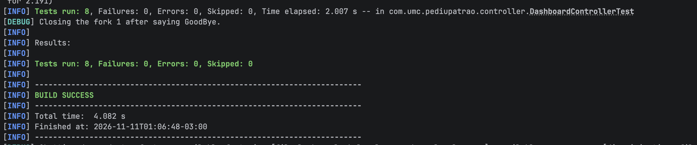

O dashboard do **Pediu Patrão** fica em `/dashboard` e ajuda admins e gerentes a acompanhar as vendas e a situação dos pedidos em um só lugar.

## Requisitos

| Tipo | O que foi implementado |
|---|---|
| Funcional | Mostrar total de pedidos, pedidos finalizados, faturamento e ticket médio. |
| Funcional | Exibir gráficos de faturamento diário e pedidos por status, além do ranking dos 10 produtos mais vendidos. |
| Funcional | Filtrar por data e status e mostrar mensagens de carregamento, consulta vazia ou erro. |
| Não funcional | Usar o login do projeto e liberar a página e a API apenas para `ADMIN` e `GERENTE`. |
| Não funcional | Adaptar o painel ao tamanho da tela, calcular valores com duas casas decimais e apresentar erros sem expor detalhes internos do banco. |

Por padrão, o painel mostra os **últimos 30 dias**. O faturamento, o ticket médio e o ranking consideram só os pedidos finalizados. O faturamento já inclui os descontos, e o ranking usa a quantidade vendida.

## API

O endpoint `GET /api/dashboard` usa a sessão do login e retorna todos os dados do painel em JSON.

| Parâmetro | Como funciona |
|---|---|
| `inicio` | Data inicial em `AAAA-MM-DD`. Quando omitida, usa 29 dias antes de `fim`. |
| `fim` | Data final em `AAAA-MM-DD`. Quando omitida, usa a data atual do servidor. |
| `status` | Opcional. Aceita `RECEBIDO`, `EM_PREPARACAO`, `PRONTO`, `SAIU_PARA_ENTREGA`, `RETIRADO`, `FINALIZADO` ou `CANCELADO`. Em branco, inclui todos. |

As datas inicial e final entram na consulta. O intervalo máximo é de 366 dias.

**Exemplo de requisição**

```http
GET /api/dashboard?inicio=2026-11-10&fim=2026-11-10
Accept: application/json
```

**Exemplo de resposta**

```json
{
  "inicio": "2026-11-10",
  "fim": "2026-11-10",
  "status": null,
  "totalPedidos": 3,
  "pedidosFinalizados": 1,
  "faturamento": 90.00,
  "ticketMedio": 90.00,
  "vendasPorDia": [{"data": "2026-11-10", "faturamento": 90.00}],
  "pedidosPorStatus": {
    "RECEBIDO": 1,
    "EM_PREPARACAO": 0,
    "PRONTO": 0,
    "SAIU_PARA_ENTREGA": 0,
    "RETIRADO": 0,
    "FINALIZADO": 1,
    "CANCELADO": 1
  },
  "produtosMaisVendidos": [
    {"produtoId": "p1", "nome": "Pizza de calabresa", "quantidade": 2}
  ]
}
```

| HTTP | Quando acontece |
|---|---|
| `200` | Consulta concluída, inclusive quando o período está vazio. |
| `400` | Data ou status inválido, período invertido ou intervalo acima de 366 dias. |
| `401` | Usuário sem login. |
| `403` | Usuário sem permissão. |
| `503` | Falha ao acessar o banco. |
| `500` | Erro inesperado da aplicação. |

## Código e decisões do projeto

O repositório busca os pedidos no **MongoDB**, o serviço Java calcula os indicadores e o controller devolve o JSON. A página usa o **Chart.js** que já estava no projeto. Com um único endpoint, o painel carrega tudo em uma chamada e usa os mesmos filtros nos indicadores, nos gráficos e no ranking.

A branch de entrega no GitHub é `feature/dashboard-administrativo`, a partir de `develop`, com o código da API, do painel e dos testes.

## Evidências de testes

O `DashboardControllerTest` passou nos **8 testes** com `./mvnw test`. Foram verificados os cálculos, o ranking, os filtros, as consultas vazias, as permissões e o tratamento de falhas no banco.

**Captura do terminal com os testes passando**



A suíte usa MockMvc com um repositório simulado. A demonstração do painel com dados do MongoDB Atlas complementa essa evidência.
